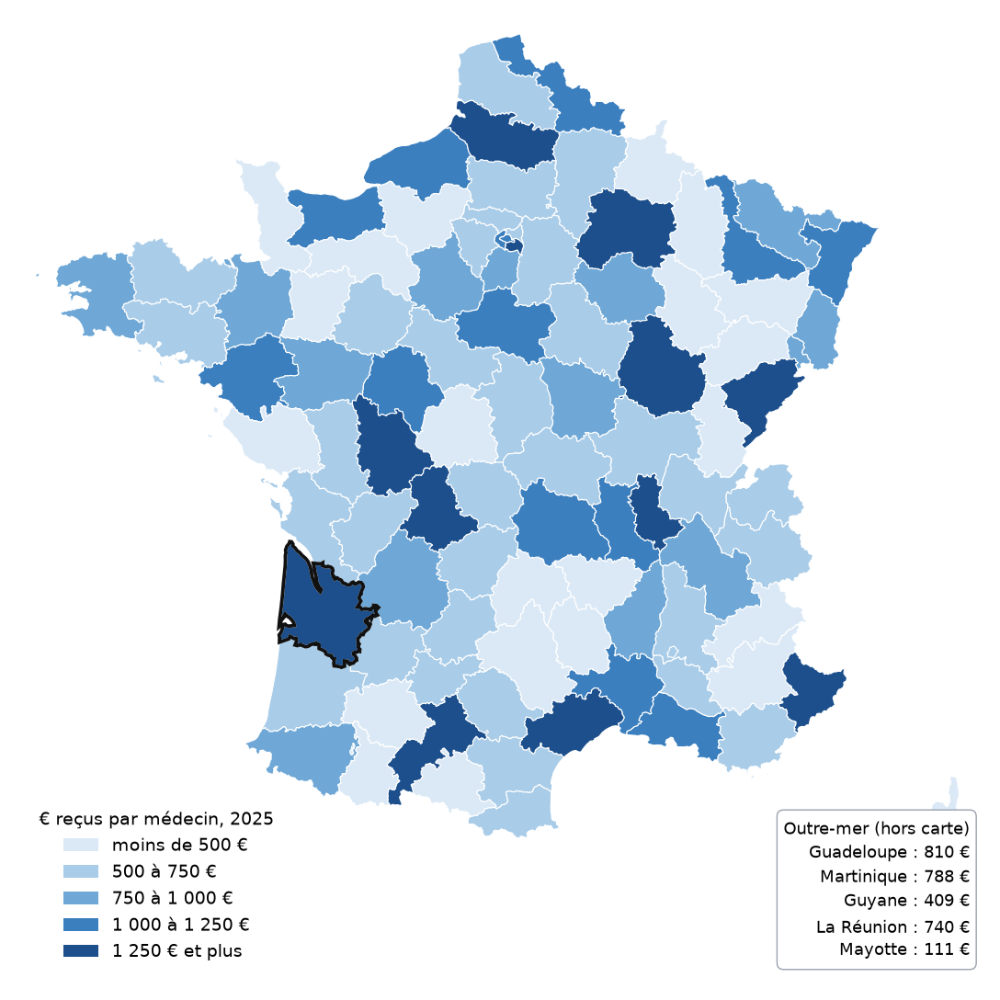

# Suivre l'argent des laboratoires : méthode, trouvailles et pistes

Hackathon Transparence Santé, Le Wagon Bordeaux, 24 novembre 2026. Document mis à jour après une revue complète du code
(corrections du 25 novembre 2026). Auteur : Thomas Labarriere.

Ce document explique ce que nous avons construit, comment, avec quelles données, ce que nous avons trouvé et ce qu'il
reste à faire. Il s'adresse à une équipe qui voudrait reprendre le travail ou l'intégrer à ses propres outils. Tout le
code est dans ce dépôt ; chaque chiffre cité se recalcule avec les scripts indiqués entre crochets, par exemple [21].

**Précautions de lecture.** Un lien financier entre un laboratoire et un acteur de santé n'est pas une irrégularité :
ces versements sont légaux, déclarés et publics. Les rapprochements par nom comportent des homonymes possibles. Les
fichiers de `resultats/` nomment des personnes à partir de données publiques (voir la section 9).

---

## Sommaire

1. [En bref](#1-en-bref)
2. [Le problème de départ](#2-le-problème-de-départ)
3. [Architecture technique](#3-architecture-technique)
4. [Chantier 1 : rattacher les structures « AUTRE » à un SIREN ou un RNA](#4-chantier-1--rattacher-les-structures-autre-à-un-siren-ou-un-rna)
5. [Chantier 2 : croiser Transparence Santé avec sept autres bases](#5-chantier-2--croiser-transparence-santé-avec-sept-autres-bases)
6. [Fiche par base de données](#6-fiche-par-base-de-données)
7. [Les pièges que nous avons rencontrés](#7-les-pièges-que-nous-avons-rencontrés)
8. [Ce que la revue de code a changé](#8-ce-que-la-revue-de-code-a-changé)
9. [Données personnelles et publication](#9-données-personnelles-et-publication)
10. [Recommandations pour les producteurs de données](#10-recommandations-pour-les-producteurs-de-données)
11. [Ce qu'on pourrait faire ensuite](#11-ce-quon-pourrait-faire-ensuite)
12. [Reproduire les résultats](#12-reproduire-les-résultats)
13. [Sources](#13-sources)

---

## 1. En bref

- **Le double compte.** Dans Transparence Santé, une convention et les rémunérations qui l'exécutent sont
  déclarées séparément, avec le même argent. Additionner les trois types de liens compte deux fois 6,4 Md€.
  Sur 2012 à 2026 : 19,2 Md€ déclarés au total, 12,8 Md€ versés une seule fois. Tous nos chiffres sont nets.
- **Les structures sans identifiant.** Sur 88 105 structures sans identifiant exploitable (5,52 Md€ bruts, 3,9 Md€ nets), 17 312 sont
  rattachées de façon fiable à leur SIREN ou RNA : 78 % des euros. Erreur probable mesurée : 2,0 % des cas.
- **La Sécurité sociale.** Elle a remboursé 27,4 Md€ de médicaments en 2025 (Open Medic). 7,3 Md€ (26,7 %) vont à
  des médicaments dont le meilleur avis de la HAS est « ASMR V » : aucun progrès par rapport à l'existant.
- **Qui les labos paient.** Un médecin spécialiste reçoit en moyenne 1 441 € par an, un généraliste 222 €, alors
  que les généralistes prescrivent 8,6 Md€ en ville contre 4,4 Md€ pour les spécialistes libéraux.
  L'écart tient en médiane (554 € contre 128 € parmi les médecins payés) : ce ne sont pas quelques cas extrêmes.
- **La concentration.** 1 % des professionnels de santé payés reçoivent 50 % des euros versés aux professionnels.
- **Les experts de la HAS.** Les 42 membres des commissions qui évaluent médicaments et dispositifs, identifiés avec
  certitude ou forte probabilité, ont reçu 324 k€ en quinze ans, dont 43 k€ pendant leur mandat actuel ;
  28 d'entre eux n'ont rien reçu pendant le mandat.
- **Les marchés des hôpitaux.** De 2023 à 2026, 39 hôpitaux ont à la fois reçu de l'argent d'un labo et passé au
  moins un marché public avec lui : 212 paires, 83 M€ de versements, 1 025 marchés.
- **Le lobbying.** 122 groupes qui versent de l'argent dans Transparence Santé sont aussi inscrits au registre des
  représentants d'intérêts. Ils déclarent 92 M€ de dépenses de lobbying sur 2022 à 2025.
- **Les anomalies.** 35 lignes de 10 M€ ou plus pèsent 10 % de tout l'argent net déclaré. La plus grosse, 445 M€
  d'une seule convention vers un centre de lutte contre le cancer, ressemble à une erreur de saisie. 98 % des euros
  de rémunérations versés aux professionnels n'ont aucun motif déclaré [33].
- **Les prestataires.** 4,6 Md€, 36 % de l'argent net déclaré, vont à des sociétés payées pour un service : agences
  de communication, sociétés de recherche sous contrat, informatique, conseil, événementiel, grossistes. Hors
  prestataires, il reste 8,2 Md€ versés aux soignants, hôpitaux, associations et sociétés savantes [34].
- **Les élus et leurs déclarations.** Sur 132 élus qui portent le nom d'un soignant payé, 54 ont une déclaration
  d'intérêts publiée ; 10 ont reçu des contrats de labos dans les cinq ans avant, et aucune déclaration ne nomme le
  labo. Le principal cas (41,5 k€) coïncide avec un emploi salarié déclaré, employeur masqué : la comparaison ne
  révèle pas d'omission établie [35].

---

## 2. Le problème de départ

Transparence Santé publie environ 10,5 millions de déclarations (2012 à 2026) : conventions, rémunérations et
avantages accordés par 4 458 entreprises à des professionnels de santé et à des structures. Pour qu'un citoyen ou un
journaliste puisse suivre l'argent, il faut savoir **qui** a reçu. Or :

- 1,54 million de déclarations désignent leur bénéficiaire avec un identifiant de type « AUTRE ». Pour les
  structures (hors professionnels), cela représente 519 992 lignes et 5,52 Md€ bruts (3,9 Md€ nets) sans SIREN,
  sans RNA ni FINESS exploitable.
- Une même structure apparaît sous des dizaines d'écritures : « ASSISTANCE PUBLIQUE HOPITAUX DE PARIS »,
  « Assistance Publique ¿ Hopitaux de Paris », etc. (39 variantes pour l'AP-HP).
- Le montant d'une convention et celui des rémunérations qui l'exécutent s'additionnent si on n'y prend pas garde.

Nous avons donc mené deux chantiers : rattacher chaque structure à son identifiant officiel (chantier 1), puis
croiser la base avec d'autres données publiques pour donner du contexte aux montants (chantier 2).

---

## 3. Architecture technique

```
                 sources publiques (data.gouv.fr, HATVP, BDPM, Open Medic, ClinicalTrials.gov, HAS)
                                        |
                       scripts/telecharger.py  (URL à jour via l'API data.gouv)
                                        |
                                    data/  (≈ 10 Go, jamais versionné)
                                        |
         +------------------------------+-------------------------------+
         |                                                              |
 Chantier 1 : rattachement (00 à 14)                     Chantier 2 : croisements (21 à 35)
 DuckDB data/travail.duckdb                              DuckDB en mémoire sur les parquet annuels
 normalisation -> identifiants cachés ->                 vue ts_net (sans double compte)
 exact -> approximatif -> arbitrage IA ->                groupes de labos communs (commun.py)
 garde-fous -> test de vérité -> PDF                     BDPM, Open Medic, HATVP, RPPS, DECP, essais, HAS
         |                                                              |
         +------------------------------+-------------------------------+
                                        |
                        out/  (sorties complètes, nominatives, locales)
                                        |
                    scripts/99_exporter_public.py  (liste des fichiers publiés)  
                                        |
                              resultats/  (résultats publiés)
```

**Choix techniques.**

- **DuckDB** pour tout ce qui est volumineux : SIRENE (≈ 30 M d'établissements), RNA, Transparence Santé.
  Les fichiers parquet se lisent sans import préalable, et une jointure sur 10 millions de lignes prend quelques
  secondes sur un portable.
- **rapidfuzz** pour la similarité de noms. On utilise la moyenne de `token_set_ratio` et de `token_sort_ratio` :
  `token_set_ratio` seul donne 100 à un nom inclus dans l'autre (« PARIS » dans « ESSENCEMEDIACOM PARIS »).
- **pandas** pour la mise en forme, **reportlab** et **matplotlib** pour les rapports PDF et la carte.
- **Claude** (sous-agents Claude Code, modèles Haiku 5.5 puis Sonnet 5.5) pour arbitrer les cas douteux du
  chantier 1. L'IA ne fait que choisir parmi des candidats déjà trouvés dans les registres ; elle n'écrit jamais un
  numéro. Les consignes exactes sont versionnées : [`resultats/arbitrage/CONSIGNES.md`](../resultats/arbitrage/CONSIGNES.md).
- **Une seule source de vérité** pour les fonctions partagées (`scripts/commun.py`) : normalisation des noms,
  département depuis un code postal (Corse, outre-mer), vue nette de Transparence Santé, groupes de laboratoires,
  lecture des fichiers BDPM et Open Medic.

---

## 4. Chantier 1 : rattacher les structures « AUTRE » à un SIREN ou un RNA

### 4.1 Méthode, étape par étape

| Étape | Script | Ce qu'elle fait |
|---|---|---|
| 0 | `00_telecharger.sh` | Extrait Transparence Santé « AUTRE » hors professionnels, SIRENE (parquet), RNA. |
| 1 | `01_regrouper.py` | Normalise les noms (majuscules, sans accents, sans formes juridiques ni mots vides) et regroupe par nom normalisé + département. 519 992 lignes deviennent 88 105 structures. Un code postal étranger ne donne pas de département. |
| 2 | `02_referentiels.py` | Prépare les annuaires : unités légales SIRENE (personnes morales), établissements, associations RNA, avec toutes les variantes de nom (dénomination, sigle, enseignes). |
| 3 | `03_identifiants_caches.py` | Cherche un RNA (W + 9 caractères) ou un SIREN / SIRET (clé de Luhn vérifiée) écrit dans l'identifiant, le nom ou l'adresse. Le SIREN du laboratoire déclarant est écarté (souvent recopié par erreur). 13 892 structures, 2,37 Md€ bruts. |
| 4 | `04_rapprochement_exact.py` | Nom + département (confiance 0,9), sigle + département (0,85), nom unique en France (0,8). Plusieurs candidats : « ambigu ». |
| 5 | `05_bilan.py` | Contrôle de cohérence (similarité nom déclaré / nom officiel ≥ 80) et exclusion des catégories qui désignent souvent une personne (étudiant, influenceur, vétérinaire). |
| 6 | `06_rapprochement_approx.py` | Même département + un des deux mots les plus rares du nom, score rapidfuzz. Accepté sans IA si quasi identique (score strict ≥ 95) et sans concurrent proche. |
| 7 | `07_file_arbitrage.py` | Les 5 000 plus gros cas douteux partent en lots JSONL de 200, avec jusqu'à 8 candidats officiels chacun. |
| 7b | (sous-agents) | Haiku arbitre chaque lot ; Sonnet relit à l'aveugle les cas hésitants et les plus grosses décisions. |
| 8 | `08_integrer_arbitrage.py` | Contrôle chaque décision (le choix doit être un candidat proposé ; un nom proposé doit exister au registre), applique les garde-fous homonymes, produit le résultat final. |
| 9 à 11 | `09`, `10`, `11` | Dirigeants des sociétés (API recherche-entreprises), échantillon de contrôle humain, dirigeants payés aussi à titre personnel. |
| 12, 14 | `12_test_verite.py`, `14_test_verite_ia.py` | Mesure de l'erreur sans humain (voir 4.3). |
| 13 | `13_rapport.py` | Compte rendu PDF du mois ou de la semaine. |

### 4.2 Résultat

Base : 519 992 versements regroupés en 88 105 structures, 5,52 Md€ bruts (3,9 Md€ nets).

| Statut | Structures | Md€ bruts | % des euros bruts | % des euros nets |
|---|---|---|---|---|
| fiable | 17 312 | 4,32 | 78,3 % | 78,6 % |
| non rattaché (vu par l'IA, aucun candidat juste) | 1 889 | 0,62 | 11,3 % | 10,4 % |
| à vérifier | 18 671 | 0,49 | 8,9 % | 9,4 % |
| non rattaché (petits montants, non arbitrés) | 30 385 | 0,07 | 1,3 % | 1,4 % |
| plusieurs candidats | 19 848 | 0,02 | 0,3 % | 0,3 % |

D'où viennent les « fiables » (en euros bruts) : identifiant écrit dans le texte 1,59 Md€ ; nom + département
1,14 Md€ ; arbitrage IA relu par un second modèle 0,85 Md€ ; nom unique en France 0,21 Md€ ; arbitrage IA simple
0,15 Md€ ; le reste par sigle, nom proposé par l'IA et trouvé au registre, ou rapprochement approximatif.
Avant l'arbitrage IA, seuls 51,8 % des euros étaient rattachés. 758 structures (45 M€) ont été déclassées par les
garde-fous homonymes.

« Fiable » veut dire : identifiant écrit dans le texte, ou rapprochement exact cohérent, ou décision de l'IA en
confiance haute sans désaccord entre les deux modèles, et aucun garde-fou déclenché. Les garde-fous font repasser
« à vérifier » : une SCI ou une société immobilière trouvée par le nom seul, un nom d'un seul mot court dont
l'activité n'a rien à voir avec la santé, un sigle de 5 caractères ou moins choisi par le premier modèle et absent du
nom officiel, et toute catégorie « personne » trouvée par le nom seul.

### 4.3 Combien d'erreurs ? Le test de vérité

On ne peut pas contrôler 17 000 rattachements à la main. Nous avons donc fabriqué une vérité terrain : les
13 500 structures dont l'identifiant était écrit dans le texte. On efface cet identifiant, on rejoue les étapes 3 et
4, et on compare au vrai numéro [12].

- **Règles automatiques** (13 552 structures, 2,03 Md€ ; 3 690 ont reçu une réponse) : parmi ces 3 690 réponses,
  92,8 % sont identiques à la vérité (95,6 % des euros). Les écarts se répartissent ainsi : même nom sous un autre numéro (doublon probable du registre, 77 cas),
  numéro écrit par le labo qui semble faux alors que notre réponse colle au nom (114 cas), et **erreur probable de
  notre part : 73 cas sur 3 690 « fiables », soit 2,0 % des cas et 1,0 % des euros.**
- **IA** (200 cas douteux de ce jeu, arbitrés sans voir la réponse) : 134 « aucun » justifiés (la bonne réponse
  n'était pas parmi les candidats), 1 « aucun » à tort. En confiance haute, le script compte 49 justes et 7 faux ;
  la relecture des 7 montre que 5 sont la même entité sous un autre numéro (SIREN et RNA d'une même association),
  soit **54 justes sur 56**. Les 2 vraies erreurs portent sur des sigles de 3 lettres (« adf », « A.F.C. ») :
  d'où le garde-fou sur les sigles courts.

Un échantillon de 100 cas (60 au hasard, 40 au prorata des euros) est prêt pour un contrôle humain, avec le lien vers
la fiche officielle de chaque entité [10]. Il a été laissé sans avis d'IA pour ne pas influencer le contrôleur.

### 4.4 Reproductibilité de l'arbitrage IA

Une décision d'IA ne doit pas changer à chaque exécution. Chaque cas porte une **empreinte** : identité de la
structure (nom normalisé + département) et liste triée de ses candidats. Un cas dont l'empreinte n'a pas changé n'est
jamais réarbitré ; un cas modifié repart en lot, et l'ancienne décision devient « périmée ». Un journal de toutes les
décisions et un manifeste (empreinte des consignes, modèles, nombre de cas) sont produits à chaque intégration.
Les lots, décisions et révisions sont publiés dans `resultats/arbitrage/` : l'étape 8 se rejoue sans relancer d'IA.

### 4.5 Dirigeants

Seules les sociétés ont leurs dirigeants en données ouvertes (registre RNE, via l'API recherche-entreprises).
Les associations, sociétés savantes et hôpitaux n'en ont pas. Deux croisements [09, 11] :

- **Structure dirigée par le labo qui la paie.** Exemple type : le GERS, groupement d'intérêt économique de
  statistiques de ventes administré par des laboratoires, qui a reçu 24,4 M€ nets de 27 d'entre eux. Ce n'est
  pas de l'influence : une partie des montants déclarés est de l'argent que l'industrie se verse à elle-même.
- **Dirigeant payé aussi à titre personnel par le même labo** (correspondance nom + premier prénom, à vérifier une à
  une). Montants nets des deux côtés ; seuls les cas où la personne est payée dans le département de la structure
  sont publiés : 141 personnes, 77 structures (`resultats/croisement_dirigeants_professionnels.csv`).

---

## 5. Chantier 2 : croiser Transparence Santé avec sept autres bases

### 5.1 Remboursements et versements, par labo [21]

Chaîne : Open Medic 2025 (remboursement par présentation CIP13) → BDPM CIS_CIP (CIP13 vers médicament CIS) → BDPM CIS
(labo titulaire). 100 % des euros remboursés retrouvent leur titulaire. Puis appariement du titulaire au déclarant de
Transparence Santé par groupe.

| Groupe | Remboursé 2025 | Versé 2025 (net) | € versés pour 1 000 € remboursés |
|---|---|---|---|
| Servier | 114 M€ | 25 M€ | 222 |
| MSD | 293 M€ | 63 M€ | 215 |
| Sanofi | 1 062 M€ | 228 M€ | 214 |
| Amgen | 648 M€ | 101 M€ | 156 |
| Boehringer Ingelheim | 339 M€ | 42 M€ | 123 |
| Roche | 753 M€ | 73 M€ | 97 |
| Pfizer | 1 857 M€ | 118 M€ | 64 |
| Novartis | 1 876 M€ | 64 M€ | 34 |
| Biogaran (génériques) | 1 294 M€ | 2 M€ | 2 |

Lecture : le ratio est un ordre de grandeur. Le versement couvre toutes les activités du groupe (médicament, mais
aussi dispositifs, diagnostic, dermo-cosmétique), le remboursement seulement le médicament de ville et rétrocédé.
Les génériqueurs versent très peu : l'argent va là où il y a une marque à défendre.

### 5.2 Le progrès thérapeutique de ce que l'on rembourse [26]

On retient pour chaque médicament le **meilleur** avis ASMR jamais obtenu (hypothèse la plus favorable aux labos :
une extension d'indication reçoit souvent V alors que l'indication initiale avait mieux).

| ASMR | Signification | Remboursé 2025 | Part |
|---|---|---|---|
| I | progrès majeur | 0,96 Md€ | 3,5 % |
| II | important | 1,72 Md€ | 6,3 % |
| III | modéré | 5,30 Md€ | 19,3 % |
| IV | mineur | 6,16 Md€ | 22,5 % |
| V | aucun progrès | 7,34 Md€ | 26,7 % |
| sans avis | génériques, médicaments anciens | 5,95 Md€ | 21,7 % |

Un médicament ASMR V n'est pas inutile (il peut être moins cher ou mieux toléré) ; il n'apporte pas de progrès par
rapport aux traitements existants selon la HAS.

### 5.3 Qui est qui : marques et labos [30]

9 135 marques reliées à leur titulaire et à son groupe ; 4 733 ont des remboursements en 2025. Pour chaque marque :
substance, meilleur ASMR, remboursement, et pour son groupe : versements nets, lobbying. Fichier :
[`resultats/marques_labos.csv`](../resultats/marques_labos.csv).

Exemples : Vyndaqel (Pfizer) 1,07 Md€ remboursés ; Eliquis (titulaire Bristol-Myers Squibb, co-commercialisé avec
Pfizer) 0,89 Md€ ; Eylea (Bayer) 0,61 Md€ ; Kaftrio (Vertex, ASMR I) 0,47 Md€ ; Dupixent (Sanofi) 0,44 Md€.
Le Doliprane appartient désormais à Opella, plus à Sanofi.

### 5.4 Spécialités médicales [31]

Le RPPS donne la spécialité de chaque médecin. On ne retient que les médecins en activité (251 576 personnes ;
le fichier brut compte 401 688 inscrits) et une table explicite libellé → spécialité alignée sur les codes
prescripteurs d'Open Medic. 95,7 % des euros versés aux médecins en 2025 sont rattachés à un médecin du RPPS.

| Spécialité | Médecins | Payés | € moyen | € médian des payés | Prescrit en libéral 2025 |
|---|---|---|---|---|---|
| Médecine générale | 104 128 | 33 % | 222 | 128 | 8,55 Md€ |
| Ensemble des spécialistes | 146 664 | 49 % | 1 441 | 554 | 4,44 Md€ |
| Gastro-entérologie | 4 170 | 77 % | 3 601 | 1 268 | 262 M€ |
| Dermatologie | 3 797 | 83 % | 3 909 | 1 081 | 297 M€ |
| Pneumologie | 3 572 | 81 % | 3 711 | 2 092 | 296 M€ |
| Rhumatologie | 2 655 | 79 % | 3 248 | 1 768 | 460 M€ |
| Cardiologie | 8 016 | 75 % | 2 905 | 1 034 | 542 M€ |
| Psychiatrie | 16 493 | 19 % | 139 | 59 | 158 M€ |

Les généralistes reçoivent 10 % des euros versés aux médecins alors qu'ils signent les deux tiers des prescriptions
libérales de médicaments (8,55 Md€ sur 13 Md€). Les labos paient là où se décident les traitements coûteux et les initiations. C'est une corrélation de
ciblage, pas une preuve d'influence. Limite : 13,5 Md€ de prescriptions hospitalières (code 90 d'Open Medic) ne sont
pas ventilés par spécialité.

### 5.5 Carte par département [31, 32]

Euros reçus en 2025 par médecin en activité, 100 départements (outre-mer en encart).
Haute-Garonne (1 667 €), Rhône et Val-de-Marne en tête ; Lozère et Mayotte (111 €) en queue.
**Gironde : 1 317 € par médecin, 10e sur 100**, 47 % des médecins payés. Le rang tient sans les plus gros
bénéficiaires (10e aussi en moyenne hors 1 % les plus payés ; 13e en médiane).



### 5.6 Professionnels de santé et concentration [24]

1,33 Md€ nets déclarés pour 778 116 professionnels de santé (2012 à 2026), dont 373 M€ de conventions qu'aucun
versement ne vient exécuter (souvent des maxima). Une personne est identifiée par son RPPS quand il est valide
(11 chiffres, clé de Luhn, pas plus de 5 noms différents), sinon par nom + premier prénom + département : les
identifiants factices ([SO], 0, 00000000000...) fusionnaient sinon des milliers de personnes. 1 % des bénéficiaires
reçoivent 50 % des euros ; la médiane est de 70 €, 1 858 personnes dépassent 100 000 €.

Responsables publics : 132 élus de la liste HATVP portent les mêmes nom, premier prénom et département qu'un
professionnel de santé payé (160 professionnels, 0,48 M€ au total). Un déclarant HATVP sans département n'est jamais
rapproché ; l'outre-mer est inclus. Pour 53 lignes, plusieurs professionnels distincts correspondent au même élu :
homonymie certaine pour au moins l'un d'eux. Ces correspondances sont des pistes, pas des constats.

### 5.7 Lobbying [22]

Le répertoire de la HATVP publie, par exercice, une tranche de dépenses et des fiches d'activité. Une organisation
est rattachée à un déclarant de Transparence Santé si son SIREN est le même, ou si son groupe est celui d'un labo dont
des médicaments sont remboursés. Résultat : 122 groupes, 92 M€ déclarés sur 2022 à 2025 (milieu de tranche),
1 889 fiches d'activité dans le domaine de la santé. Premiers groupes : Sanofi (7,6 M€), Vertex (5,3 M€), Roche
(4,1 M€), MSD et AbbVie (3,7 M€). Cibles les plus fréquentes : parlementaires et leurs collaborateurs, Présidence de la
République, emplois à la décision du Gouvernement, cabinets des ministres de la santé.

### 5.8 Déclarations d'intérêts des élus [23]

Dans 6 268 déclarations d'intérêts publiées par la HATVP, 96 mentions de laboratoires ou d'entreprises de santé
par 52 responsables publics, dont 82 participations financières (actions détenues). Les détenteurs d'actions Sanofi
et Essilor dominent. Ce sont des déclarations faites par les intéressés : la transparence fonctionne.

### 5.9 Experts de la HAS [27]

Les membres de la Commission de la transparence (médicaments) et de la CNEDiMTS (dispositifs) sont publiés sur
has-sante.fr. 64 membres, 48 retrouvés dans Transparence Santé. Après levée des homonymes (même RPPS sur plusieurs
lignes, département de la page HAS, profession compatible) : 42 sûrs ou probables, 6 homonymes possibles écartés.

- 324 k€ nets reçus en quinze ans par les 42, médiane 890 € par membre. Un expert = une seule personne (un RPPS) :
  deux RPPS différents ne sont jamais additionnés, et aucun total n'est publié pour un homonyme possible.
- 43 k€ pendant le mandat en cours (35 k€ hors conventions) ; 28 membres n'ont rien reçu pendant le mandat.

C'est une bonne nouvelle : les gardiens de l'évaluation sont peu payés par l'industrie, et la HAS gère leurs déports.
DPI-Santé (les déclarations publiques d'intérêts) aurait permis de confronter déclaré et versé, mais le site impose un
captcha par déclaration : nous ne l'avons pas contourné.

### 5.10 Essais cliniques [29]

ClinicalTrials.gov (API v2) : 5 346 essais à promoteur industriel avec au moins un site en France depuis 2019.
Côté Transparence Santé, 91 597 conventions avec des établissements : 57 % portent un motif de recherche, et elles
pèsent 80 % des euros. Un gros montant versé à un hôpital est donc d'abord de la recherche clinique.
À Bordeaux, l'Institut Bergonié accueille 144 essais de 81 promoteurs. Limite : le rapprochement essais /
conventions se fait par ville et par groupe, pas par établissement.

### 5.11 Marchés publics des hôpitaux [28]

Données essentielles de la commande publique (DECP) des hôpitaux, croisées avec les versements des mêmes labos aux
mêmes hôpitaux. Fenêtre 2023 à 2026 (95 % des marchés retenus).

- 212 paires hôpital × labo avec les deux flux, 39 hôpitaux, 61 labos.
- 83 M€ de versements nets reçus par ces hôpitaux de ces labos.
- 1 025 marchés, dont 8 déclarés à 100 M€ ou plus. Hors ces 8, les marchés totalisent environ 2,05 Md€.

Les montants DECP sont des **maxima** (souvent des plafonds d'accords-cadres), pas des dépenses. Ce cumul est légal et
courant : un labo finance la recherche d'un CHU et lui vend aussi ses médicaments, après mise en concurrence. Ce qui
manque aujourd'hui, c'est de voir les deux chiffres côte à côte. Le CHU de Bordeaux publie très peu de marchés avec
des labos dans les DECP.

### 5.12 Anomalies de déclaration [33]

Un contrôle de vraisemblance que la base n'applique pas. Détail ligne par ligne dans
`resultats/anomalies_declarations.csv`.

- **Des lignes géantes.** 35 lignes de 10 M€ ou plus totalisent 1,31 Md€, soit 10,3 % de l'argent net déclaré de
  2012 à 2026. La première est une convention de 444 947 450 € déclarée par Syneos Health (une société de recherche
  sous contrat) vers le Centre Henri-Becquerel de Rouen le 19 mai 2025, motif « Autre », détail « recherche ». Le
  montant dépasse très probablement le budget annuel de l'établissement : une virgule déplacée (444 947,45 €) est
  l'hypothèse la plus simple. Cette seule ligne pèse 3,5 % du total national.
- **Des prestataires comptés comme bénéficiaires.** IQVIA, société de recherche clinique sous contrat, reçoit 560 M€,
  dont 348 M€ d'Abivax en 12 lignes : c'est le coût sous-traité d'essais cliniques, pas un lien d'intérêt au sens
  courant. Ces flux gonflent les totaux « versés aux acteurs de santé ».
- **Des rémunérations sans motif.** 405,5 M€ de rémunérations versées aux professionnels de santé : 98,1 % des euros
  (94 % des lignes) n'ont ni motif, ni texte libre, ni événement. Exemple : la plus grosse, 4,79 M€ en une ligne
  vers le premier bénéficiaire individuel de la base, n'en porte aucun ; c'est au déclarant de le renseigner.
- **Des hébergements impossibles.** 19 avantages « hospitalité, repas ou transport » de 20 000 € ou plus pour une
  seule personne, dont un « hébergement » de 1 307 280 € déclaré en 2023.
- **Des sociétés déclarées comme personnes.** 77 364 lignes « professionnel de santé » portent un identifiant à
  9 chiffres (un SIREN) au lieu d'un RPPS, pour 10,2 M€ ; l'une d'elles figure parmi les dix premiers bénéficiaires
  individuels (colonne `alerte` de `professionnels_top.csv`).
- **Des plafonds déclarés comme des montants.** Cinq chirurgiens, dont deux en Gironde, ont chacun une convention
  d'« expert scientifique » d'exactement 402 800 € avec le même fabricant de robots chirurgicaux. Aucune
  rémunération ne vient l'exécuter : le montant d'une convention est souvent un maximum prévu, pas une somme
  versée. Les classements individuels qui additionnent les conventions doivent être lus avec cette réserve.
- 206 montants négatifs (rectifications non documentées).

Nos totaux nets gardent ces lignes : ce sont les montants déclarés. Retirer la seule ligne de 445 M€ ramène le total
net de 12,77 à 12,33 Md€.

### 5.13 Prestataires et bénéficiaires [34]

Transparence Santé enregistre comme bénéficiaires des sociétés qui reçoivent le prix d'un service. Nous les
classons par leur activité INSEE (APE), uniquement quand ce sont des sociétés commerciales, et par le nom pour les
grandes sociétés de recherche clinique et les grossistes étrangers ou sans SIREN. Une association ou un organisme
public de recherche reste un bénéficiaire.

| Type de prestataire | M€ nets | Part du total |
|---|---|---|
| Communication, marketing, études | 1 434 | 11,2 % |
| Recherche sous contrat (CRO) | 1 235 | 9,7 % |
| Informatique, données | 749 | 5,9 % |
| Conseil | 603 | 4,7 % |
| Événementiel, congrès | 299 | 2,3 % |
| Grossistes, répartiteurs | 234 | 1,8 % |
| Voyage, hôtellerie, restauration | 27 | 0,2 % |
| **Total** | **4 582** | **35,9 %** |

Sur 12,77 Md€ nets déclarés de 2012 à 2026, 8,18 Md€ vont aux acteurs de santé eux-mêmes. Les premiers prestataires
sont IQVIA (environ 560 M€, toutes entités), une société informatique payée 281 M€ par un seul labo, un grossiste et
des agences média. Classement détaillé : `resultats/prestataires.csv` ; marquage ligne à ligne
régénéré par le script dans `data/ext/prestataires.parquet` (non versionné), pour filtrer n'importe quelle analyse.

Limites : une CRO sans SIREN et hors de notre liste de noms reste comptée comme bénéficiaire ; la presse et les
éditeurs de logiciels sont des catégories que la loi nomme expressément, mais ils figurent ici parmi les
prestataires quand leur activité est commerciale ; le code APE décrit l'activité principale, pas chaque contrat.

### 5.14 Élus payés et déclarations d'intérêts [35]

Pour chaque élu qui porte le nom, le prénom et le département d'un soignant payé (script 24), nous lisons ses
déclarations d'intérêts publiées en open data par la HATVP. Pour chaque groupe de labos qui l'a payé, nous
cherchons le nom du groupe, et ses autres noms, dans tout le texte des déclarations. Une déclaration doit lister
les activités rémunérées et de conseil des cinq années précédentes : nous comparons donc les rémunérations et
conventions de ces cinq ans. Les avantages (repas, transport) n'ont pas à y figurer.

- 132 élus, dont 54 avec au moins une déclaration publiée (les autres déclarations ne sont pas en open data).
  Quand plusieurs déclarants homonymes existent (dates de naissance différentes, jamais publiées), seul celui dont
  une déclaration porte le département de l'élu est retenu.
- 10 élus ont reçu des contrats de labos dans les cinq ans avant leur dernière déclaration (hors invitations à des
  congrès et hospitalité) : 15 paires élu × labo, 53,6 k€. Aucune des déclarations ne nomme le labo.
- Le cas principal, une députée pharmacienne payée 41,5 k€ par un fabricant de génériques en 20 versements mensuels
  de 2021 à 2023, a déclaré un emploi de pharmacienne salariée sur la même période, pour un montant du même ordre ;
  l'employeur, masqué dans la version publiée, est décrit comme « Pharmacie ». Rien ne permet de dire si c'est le
  même revenu : question à poser à l'intéressée et au déclarant.
- Les autres montants sont faibles (moins de 6 k€ par paire) : interventions ponctuelles qu'un élu peut considérer
  comme incluses dans son activité médicale déclarée.

**Conclusion honnête :** la comparaison est faisable et automatisée, mais elle ne révèle pas d'omission avérée. Elle
devient réellement probante avec les déclarations non publiées en open data, et avec une réponse du déclarant.
Fichier : `resultats/elus_declarations_vs_versements.csv` (colonnes `labo_cite_dans_declaration`,
`activite_sante_declaree`, `conseil_declare_neant`, `personnes_meme_nom`).

---

## 6. Fiche par base de données

Pour chaque base : ce qu'elle contient, comment l'obtenir, ses pièges, ce qu'elle nous a permis, ce qu'on peut en
faire de plus.

### 6.1 Transparence Santé

- **Contenu.** Déclarations des entreprises : conventions, rémunérations, avantages ; bénéficiaire (professionnel ou
  structure), montant, date, motif. 10,5 M de lignes, 51 colonnes.
- **Accès.** API Opendatasoft du site (`/api/explore/v2.1/catalog/datasets/declarations/exports/parquet`).
- **Pièges.**
  - L'export complet est **tronqué** par le serveur sans message d'erreur. Il faut l'exporter année par année
    (`where=year(date)=AAAA`) et vérifier que chaque parquet se termine par les octets `PAR1`.
  - **Double compte** convention / rémunération / avantage : retirer les conventions dont l'`identifiant_unique`
    est cité par le champ `convention_liee` d'un versement de la même entreprise (6,4 Md€).
  - Identifiants « AUTRE » : 30 % des lignes vers des structures n'ont aucun identifiant utilisable.
  - Les montants avant 2021 sont très faibles : la base a beaucoup gagné en complétude depuis.
- **Usage ici.** Toutes les analyses ; vue nette `ts_net` dans `commun.vues_ts()`.
- **De plus.** Séries temporelles par labo et par motif ; détection d'anomalies déclaratives (montants ronds, dates
  incohérentes, doublons) ; rapprochement systématique avec FINESS pour les établissements.

### 6.2 SIRENE (INSEE)

- **Contenu.** Toutes les entreprises et administrations : SIREN, dénomination, sigle, enseignes, forme juridique,
  activité (APE), état, établissements et adresses.
- **Accès.** data.gouv.fr, fichiers parquet du stock (unités légales ≈ 1 Go, établissements ≈ 3 Go).
- **Pièges.** L'URL change à chaque mise à jour (horodatage) : nous la résolvons par l'API data.gouv. Les entreprises
  individuelles (catégorie 1000) sont écartées. Le nom d'un hôpital public n'est pas toujours celui de l'usage.
- **Usage ici.** Référentiel du rapprochement, contrôle de forme juridique et d'activité (garde-fous SCI, santé).

### 6.3 RNA (ministère de l'Intérieur)

- **Contenu.** Les associations : numéro W, titre, titre court, adresse, position (active, dissoute).
- **Accès.** data.gouv.fr, archive mensuelle `rna_waldec_AAAAMMJJ.zip`.
- **Pièges.** Une association a souvent un SIREN **et** un RNA : deux numéros pour la même entité. Nous ne comptons
  pas ce cas comme un désaccord entre modèles.

### 6.4 Base de données publique des médicaments (BDPM)

- **Contenu.** Médicaments (CIS), présentations (CIP13), titulaire, composition, génériques, avis SMR et ASMR de la HAS.
- **Accès.** `base-donnees-publique.medicaments.gouv.fr/download/file/<fichier>.txt`.
- **Pièges.** Fichiers tabulés, sans en-tête, en latin-1, avec des guillemets non fermés : `quoting=3` obligatoire.
  Plusieurs avis ASMR par médicament : choisir une règle (nous prenons le meilleur).
- **Usage ici.** Le pont marque → labo, et le progrès thérapeutique.

### 6.5 Open Medic (Assurance maladie)

- **Contenu.** Remboursements de médicaments de ville par présentation CIP13, par âge, sexe et spécialité du
  prescripteur.
- **Accès.** `open-data-assurance-maladie.ameli.fr/medicaments/` : lien de téléchargement à **jeton** généré par la
  page, donc non automatisable. Fichiers utilisés : `NB_2025_cip13.CSV.gz` et `NB_2025_cip13_age_sexe_spe.CSV.gz`.
- **Pièges.** Montants au format « 8.739.219,66 » (point des milliers, virgule décimale). Le code spécialité 90
  regroupe les prescripteurs salariés (13,5 Md€) sans détail.
- **Usage ici.** Le dénominateur « remboursé » et les prescriptions par spécialité.

### 6.6 RPPS (Annuaire santé)

- **Contenu.** Professionnels de santé : identifiant RPPS, profession, savoir-faire (spécialités), lieux et modes
  d'exercice.
- **Accès.** data.gouv.fr, extractions en libre accès (fichiers `|`).
- **Pièges.** Le fichier contient des inscrits sans activité : filtrer sur un mode d'exercice renseigné, compter des
  personnes distinctes. Plusieurs spécialités par médecin (546 cas) : règle déterministe documentée.
- **Usage ici.** Spécialité et département de chaque médecin payé.

### 6.7 HATVP

- **Contenu.** Répertoire des représentants d'intérêts (dépenses par tranche, fiches d'activité, cibles) ; liste des
  responsables publics ; déclarations d'intérêts et de patrimoine en XML.
- **Accès.** `hatvp.fr/agora/opendata/…` et `hatvp.fr/livraison/…`.
- **Pièges.** Dépenses en tranches (on prend le milieu) ; exercices décalés (on retient l'année de fin) ;
  rattachement aux labos par le nom trop large sans garde-fou (Thales, Samsung, Nestlé).

### 6.8 DECP (commande publique)

- **Contenu.** Marchés publics : acheteur, titulaires, objet, montant, date, code CPV.
- **Accès.** data.gouv.fr, fichier consolidé `decp-global.json` (≈ 1 Go).
- **Pièges.** Montants sentinelles (999 999 999) ; plafond d'accord-cadre répété sur chaque titulaire ; dates futures ;
  montants à 1 €. Un montant DECP n'est jamais une dépense.

### 6.9 ClinicalTrials.gov

- **Contenu.** Essais cliniques mondiaux, promoteur, sites, phase, dates.
- **Accès.** API v2 publique, pagination par jeton.
- **Pièges.** Les noms d'établissements sont libres (anglais, français, services) : normalisation nécessaire.

### 6.10 HAS (composition des commissions)

- **Contenu.** Pages de composition et décisions de nomination du collège.
- **Accès.** has-sante.fr (pages HTML) ; la liste est écrite dans le script 27 avec l'URL source de chaque membre.
- **Non utilisé :** DPI-Santé, protégé par captcha.

---

## 7. Les pièges que nous avons rencontrés

| Piège | Effet | Parade |
|---|---|---|
| Export Transparence Santé complet tronqué | parquet illisible (« No magic bytes ») | export par année, contrôle `PAR1` |
| Convention + rémunération liée | 6,4 Md€ comptés deux fois | vue `ts_net` |
| `token_set_ratio` seul | 100 dès qu'un nom est inclus dans l'autre | moyenne avec `token_sort_ratio` |
| Un SIREN et un RNA pour la même association | faux désaccords entre modèles | similarité des deux noms ≥ 90 |
| SCI et sociétés immobilières homonymes | faux « fiables » | garde-fou forme juridique et APE |
| Sigles de 3 lettres choisis par l'IA | 2 erreurs en confiance haute sur 56 | garde-fou sigles courts |
| Code postal étranger | Milan (20100) classé en Corse | département seulement si pays = FR |
| Outre-mer | « 97 » traité comme un département | département sur 3 caractères pour 97x |
| Montants DECP sentinelles et plafonds | milliards fictifs | seuils, dédoublonnage, mention « plafond » |
| Inscrits RPPS sans activité | 400 000 « médecins » au lieu de 250 000 | mode d'exercice renseigné |
| Ordre des mots-clés de spécialité | « Chirurgie générale » classée en médecine générale | table explicite libellé → spécialité |
| Lien Open Medic à jeton | téléchargement automatique impossible | procédure manuelle documentée |

---

## 8. Ce que la revue de code a changé

Le 25 novembre 2026, une revue complète du code avant publication a trouvé des défauts qui faussaient certains
chiffres présentés pendant le hackathon. Ils sont corrigés ; voici ce qui a bougé.

| Chiffre | Présenté le 24/11 | Corrigé | Cause |
|---|---|---|---|
| Versés aux professionnels | 2,05 Md€ | 1,33 Md€ | double compte convention / rémunération |
| Experts HAS, total | 470 k€ | 324 k€ | idem, et un expert = une seule personne |
| Experts HAS, pendant le mandat | 71 k€ | 43 k€ | idem |
| Euros par généraliste | 283 € | 222 € | inscrits sans activité, classification des spécialités, vue nette |
| Gironde, euros par médecin | 2 229 €, 9e sur 97 | 1 317 €, 10e sur 100 | idem, et outre-mer |
| Marchés des hôpitaux | 312 paires, 218 M€, 8,8 Md€ | 212 paires, 83 M€, 1 025 marchés | plafonds répétés, fenêtre de temps, jointure dupliquée |
| Lobbying | 137 groupes, 102 M€ | 122 groupes, 92 M€ | homonymes hors santé |
| MSD | ratio aberrant (13 528 €) | 215 € | alias de groupe incohérent entre scripts |
| Rattachement fiable | 78,0 % des euros | 78,3 % (4,32 Md€ bruts ; 78,6 % des euros nets) | candidats non déterministes, garde-fous élargis |

Autres corrections : identité stable des cas d'arbitrage (une décision ne peut plus être appliquée à une autre
structure si les numéros changent), tri déterministe partout, URL de téléchargement résolues dynamiquement,
erreurs réseau plus jamais mises en cache, compte rendu mensuel qui couvrait un seul jour, chemins indépendants du
dossier courant, une seule définition des groupes de labos.

Deuxième passe (25 novembre) : le classement des professionnels affichait le nom pris au hasard parmi les lignes d'un
même RPPS. Or 32 220 RPPS portent au moins une ligne à un autre nom (erreur du déclarant) : un médecin pouvait
apparaître sous le nom d'une autre personne. Le nom affiché est désormais la forme la plus fréquente, et tous les
`any_value()` et `arg_max()` des scripts départagent les égalités de façon déterministe. Le classement sépare
aussi les conventions sans versement (souvent des plafonds) et signale les sociétés déclarées comme personnes.

Troisième passe (25 novembre, deux relectures indépendantes, l'une du code, l'autre de chaque chiffre) :

- **Identifiants factices.** « [SO] », « 0 », « NA », « 00000000000 » servaient de clé personne : un « médecin »
  du classement réunissait en fait des milliers de personnes. Une seule règle d'identité (`commun.vue_professionnels`)
  sert désormais à tous les scripts : RPPS valide, sinon nom + premier prénom + département normalisés.
- **Labo principal.** Une ligne au montant vide était choisie comme « plus gros versement » : le labo affiché était
  parfois faux. C'est maintenant le labo qui a le plus versé au total.
- **Experts de la HAS.** Plusieurs RPPS homonymes pouvaient être additionnés pour un même expert ; un seul est gardé,
  et aucun total n'est publié pour un homonyme possible.
- **Élus.** Les déclarants HATVP sans département étaient rapprochés de soignants sans département ; l'outre-mer
  était exclu par une troncature du code département ; une même personne pouvait apparaître sur plusieurs lignes.
- **Dirigeants et GERS.** Les montants venaient de l'API publique, donc bruts ; ils sont recalculés en net
  (le GERS passe de 27,9 à 24,4 M€) et le premier prénom doit correspondre exactement (JEAN n'attrape plus JEANNE).
- **Prestataires.** Un SIREN mal formé n'est plus tronqué au hasard ; États étrangers et organisations
  internationales ne sont plus classés comme sociétés.

---

## 9. Données personnelles et publication

Toutes les données nominatives de ce dépôt viennent de sources publiques : Transparence Santé, la liste des
responsables publics de la HATVP, la composition des commissions publiée par la HAS, le registre des entreprises.
`resultats/` publie donc aussi les fichiers nominatifs (professionnels les mieux payés, élus bénéficiaires, experts
de la HAS, dirigeants payés à titre personnel), avec trois garde-fous :

- **Les homonymes sont signalés.** Les croisements par nom portent une colonne de qualité (`qualite` : sûre,
  probable, homonyme possible ; `personnes_meme_nom` pour les élus). Un élu et un médecin qui portent le même nom,
  le même prénom et vivent dans le même département ne sont pas forcément la même personne.
- **Un lien n'est pas une irrégularité.** Les versements sont légaux et déclarés. Un montant inhabituel peut être
  une erreur du déclarant (section 5.12) : il ne dit rien du bénéficiaire.
- **Le droit de rectification passe par le déclarant.** Une personne qui conteste une ligne doit la faire corriger
  par l'entreprise sur Transparence Santé ; nous retirons ou corrigeons toute ligne signalée par une issue GitHub.

Point juridique à connaître : l'article R1453-7 du code de la santé publique encadre l'indexation des données
directement identifiantes par les moteurs de recherche externes, et le RGPD s'applique à toute réutilisation de
données personnelles, même publiques. D'autres réutilisateurs publient déjà ces données nominatives ; un avis
juridique reste conseillé avant une diffusion large.

---

## 10. Recommandations pour les producteurs de données

Ce que nous changerions dans Transparence Santé, par ordre d'impact :

1. **Exiger un identifiant à la déclaration** pour les structures : SIREN, RNA ou FINESS, contrôlé (clé de Luhn,
   existence dans SIRENE / RNA) au moment de la saisie. Le chantier 1 entier disparaîtrait.
2. **Publier une vue nette** ou au moins un indicateur « convention exécutée par des versements déclarés », pour que
   personne n'additionne deux fois le même argent.
3. **Corriger l'export complet**, tronqué sans erreur, ou documenter la limite.
4. **Publier le groupe** de chaque entreprise déclarante (le champ `mere_id` existe mais reste peu exploitable) :
   aujourd'hui, chacun réinvente son regroupement de filiales.
5. **Lier les déclarations aux médicaments ou dispositifs concernés** (CIS, code LPP) quand c'est le cas : on pourrait
   alors relier argent versé et produit promu.
6. **Rendre DPI-Santé téléchargeable en masse** (comme la HATVP le fait pour ses déclarations) : confronter liens
   déclarés et versements reçus est le contrôle le plus utile, et il est aujourd'hui impossible.
7. **Open Medic** : un lien de téléchargement stable, sans jeton.
8. **Contrôler la vraisemblance à la saisie** : plafond par motif (un hébergement à 1,3 M€), format de
   l'identifiant selon le type de bénéficiaire (RPPS à 11 chiffres, pas un SIREN), alerte au-delà d'un multiple du
   budget de l'établissement bénéficiaire.
9. **Rendre le motif obligatoire pour les rémunérations** : 98 % des euros versés aux professionnels sous cette forme
   n'ont aucune explication.

---

## 11. Ce qu'on pourrait faire ensuite

**Court terme**

- Faire le contrôle humain des 100 cas de `controle_100.csv` (1 heure) : c'est la seule mesure d'erreur qui ne dépend
  pas de nos propres règles.
- Planifier `run_mensuel.sh` (un compte rendu PDF par mois) ; seule l'étape d'arbitrage demande une intervention.
- Brancher l'arbitrage sur l'API Claude en mode batch au lieu de sous-agents, pour l'automatiser (moitié prix,
  traçabilité par requête).

**Moyen terme**

- Un site de consultation « qui est qui » : recherche par marque, labo, établissement ou département, avec la vue
  nette et les mises en garde.
- Le rapprochement FINESS pour tous les établissements de santé.
- Les dirigeants des sociétés savantes et associations, à partir de leurs publications (statuts, rapports annuels).
- Séries temporelles : effet des nouveaux médicaments (lancement) sur les versements aux spécialistes concernés.
- Un filtre « vraisemblance » au chargement : lignes géantes, hébergements à six chiffres, SIREN à la place d'un
  RPPS, doublons exacts entre bénéficiaires (script 33 comme point de départ), avec des totaux « avec » et « sans ».
- Appliquer le marquage des prestataires (script 34) à toutes les analyses par labo, et l'affiner contrat par
  contrat avec le motif déclaré.
- Étendre la comparaison élus / déclarations (script 35) aux déclarations non publiées en open data, et aux experts
  publics (DPI-Santé) si leur accès en masse est ouvert.

**Recherche**

- Mesurer si les versements précèdent les hausses de prescription d'un produit, par spécialité et département
  (Open Medic par spécialité × Transparence Santé par labo), en traitant correctement la causalité.
- Confronter les liens déclarés (DPI-Santé, si accessible) aux versements reçus pour les experts publics.

---

## 12. Reproduire les résultats

Voir le [README](../README.md). En résumé :

```bash
python3 -m venv .venv && .venv/bin/pip install -r requirements.txt
.venv/bin/python scripts/telecharger.py              # ≈ 11 Go ; Open Medic à la main (voir README)
./scripts/run_mensuel.sh                             # chaîne de rattachement complète
for s in 21 22 23 24 26 27 28 29 30 31 32 33 34 35; do .venv/bin/python scripts/${s}_*.py; done
.venv/bin/python scripts/99_exporter_public.py       # résultats publiés dans resultats/
.venv/bin/python -m pytest -q                       # 74 tests sans données réelles
.venv/bin/python scripts/controle.py                 # tous les contrôles sur les vraies données ; ne rien publier s'il échoue
```

Durée sur un portable récent : environ 15 minutes hors téléchargement. Mémoire : DuckDB est limité à 8 Go.

---

## 13. Sources

Toutes les données sont publiques, sous Licence Ouverte / Etalab 2.0 sauf mention contraire.

- Transparence Santé : https://www.transparence.sante.gouv.fr
- SIRENE : https://www.data.gouv.fr/datasets/base-sirene-des-entreprises-et-de-leurs-etablissements-siren-siret
- RNA : https://www.data.gouv.fr/datasets/repertoire-national-des-associations
- BDPM : https://base-donnees-publique.medicaments.gouv.fr
- Open Medic : https://open-data-assurance-maladie.ameli.fr/medicaments/
- RPPS : https://www.data.gouv.fr/datasets/annuaire-sante-extractions-des-donnees-en-libre-acces-des-professionnels-intervenant-dans-le-systeme-de-sante-rpps
- HATVP : https://www.hatvp.fr/open-data/
- DECP : https://www.data.gouv.fr/datasets/donnees-essentielles-de-la-commande-publique-fichiers-consolides
- ClinicalTrials.gov : https://clinicaltrials.gov/data-api/api
- HAS : https://www.has-sante.fr
- Contours des départements : https://github.com/gregoiredavid/france-geojson
